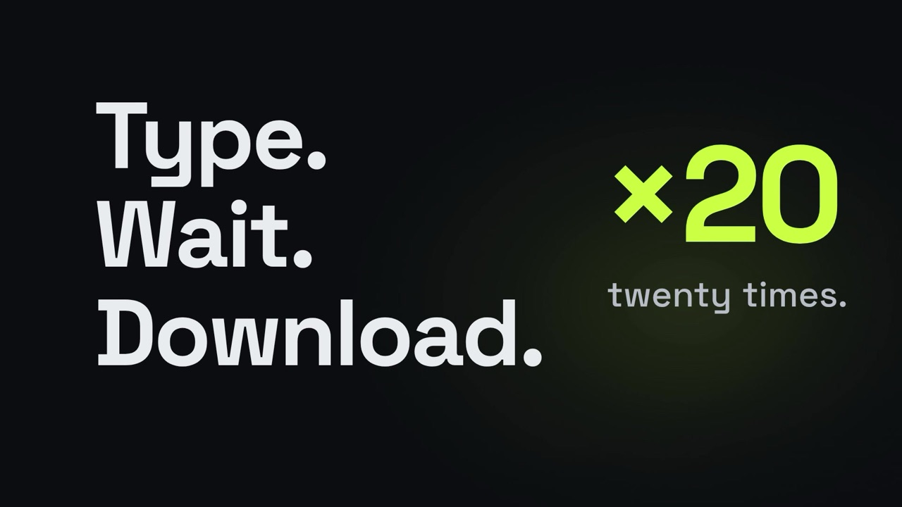
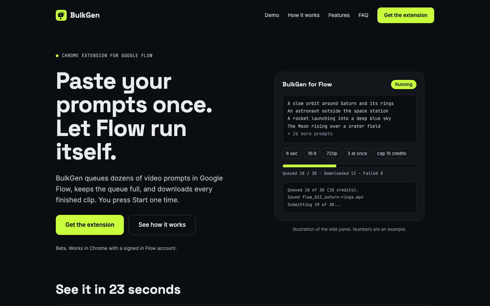

  

<h1 align="center">BulkGen for Flow</h1>

  Free, open source Chrome extension that queues dozens of video prompts in Google Flow, keeps the queue full and downloads every finished video of the project with one click.

  <a href="https://github.com/mmd-rehan/bulkgen-flow-extention/releases/latest/download/bulkgen.zip"><b>Download the latest release</b></a>
  ·
  <a href="https://bulkgen.mmd-rehan.com">Website</a>
  ·
  <a href="https://bulkgen.mmd-rehan.com/privacy">Privacy</a>

  
   
  Click to watch the 23 second demo

## What it does

Paste your prompts once, pick the model and settings, and press Start. BulkGen sends the prompts one after another, keeps up to your chosen number generating at once, and notes each video as ready when Flow finishes it. When you are ready, click "Download all videos of this project" to save them as `Downloads/BulkGen/flow_001_title.mp4`, numbered in prompt order. Nothing downloads before that click.

- Character and world notes plus a style line added to every prompt
- Reads the video models Flow offers; seconds, resolution and aspect follow the model
- Optional reference images (Ingredients), matched in order: image 1 goes with prompt 1, image 2 with prompt 2, and so on
- Checks Flow's credit estimate before sending and sends nothing above your per-video limit
- One click downloads every video of the project in 720p original or 1080p upscaled, with retries, and skips videos saved earlier
- The side panel shows only on Flow tabs
- Pause, Resume and Stop; a page reload resumes the run
- Step by step error messages and a "Copy debug info" button for bug reports
- No servers, no analytics, no data collection

  

## Install

1. Download [bulkgen.zip](https://github.com/mmd-rehan/bulkgen-flow-extention/releases/latest/download/bulkgen.zip) and unzip it to a folder you will keep.
2. Open chrome://extensions and turn on Developer mode.
3. Click "Load unpacked" and choose the folder.
4. Open your Flow project, click the BulkGen icon, paste your prompts and press Start.

## Folders

- `extension/` the Chrome extension (load this folder unpacked in chrome://extensions)
- `website/` the landing page at https://bulkgen.mmd-rehan.com (deployed by Vercel)
- `store/` Chrome Web Store listing text and images
- `screenshots/` website and demo screenshots
- `PRIVACY.md` privacy policy
- `build.sh` builds the store upload zip into `dist/`

## Release

1. Bump `version` in `extension/manifest.json`, commit and push to `main`.
2. GitHub Actions builds the zip and publishes it as a GitHub Release named `v<version>` (see the Releases page). Pushes that keep the same version do not create a release.
3. Download the zip from the release (or run `./build.sh` locally) and upload it in the Chrome Web Store developer dashboard.

## Author

Built and maintained by [Muhammad Rehan](https://www.mmd-rehan.com/), a full-stack developer in Dubai who builds web apps, websites and custom software. Find him on [GitHub](https://github.com/mmd-rehan), [LinkedIn](https://www.linkedin.com/in/mmd-rehan) and [Medium](https://medium.com/@mrrehan).

BulkGen for Flow is an independent project and is not made, endorsed or supported by Google.

## License

MIT, see [LICENSE](LICENSE).
